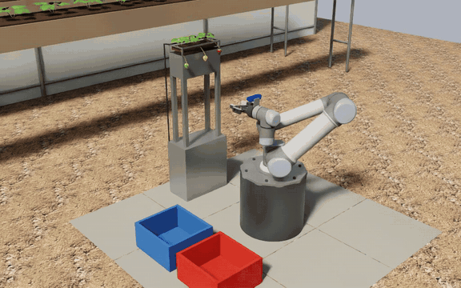

# Strawberry sorting with a UR5 in Isaac Sim

A wrist-mounted RGB-D camera looks down on three strawberries at different stages of ripeness. A UR5 arm with a Robotiq 85 gripper picks each fruit and places it in one of two bins. I ported the lab's ROS 1 and Gazebo task to Isaac Sim, including the robot and camera geometry, scene assets, RGB-D perception pipeline, and pick-and-place sequence.



[Watch the full three-fruit run (MP4, 19 s at 6× simulation speed)](demo/sorting-6x.mp4) · [See the wrist-camera detections](demo/wrist-camera-detections.png) · [Inspect the run result](demo/example-result.json)

## What happens during a pick

1. The simulated D435 wrist camera produces a 640 × 480 RGB image and a depth image. The existing YOLOv8 detector labels fruit as unripe green, intermediate yellow, or ripe red.
2. The controller takes the median valid depth near the detection center and projects it into the robot's world frame using the camera intrinsics and pose.
3. Numerical inverse kinematics generates the approach, grasp, and transfer motions. A temporary PhysX fixed joint attaches the selected fruit to the gripper during transport. After release, the script places the fruit at its assigned bin location and checks its final position.

In the recorded scene, the arm sorted green, red, then yellow in 13,950 simulation steps. Red goes into one bin and green and yellow share the other. This result covers one fixed scene. The simulation uses assisted grasping and placement. Tactile feedback for controlling grip force is planned future work.

## Try the camera localization on one frame

From a clone of this repository, the following two commands run the [one-frame example](demo/localize.py) with ordinary Python:

```bash
python -m pip install numpy scipy
python demo/localize.py
```

The [sample](demo/wrist-frame.json) contains three detections from a recorded wrist-camera image, the depth pixels at their centers, and the camera calibration and pose. The example calls the same projection function as the simulator and prints the visible surface point of each fruit in world coordinates. The saved detections let you try this step without installing Isaac Sim or loading the detector.

## Run the simulation

The recording, detection image, and result above can be viewed directly on GitHub. Running the original scene also requires a local copy of the lab's Gazebo assets. These include the robot descriptions and meshes, the strawberry models and textures, and the world file. The learned detector also requires the compatible three-class weights. This repository distributes the Isaac Sim port and the recorded demo. The original lab asset bundle and weights are separate dependencies.

From the root of this checkout, set the two paths below to your installations. The symbolic link lets the port resolve the original ROS package and model names.

```bash
export ISAAC_SIM_PATH=/path/to/isaac-sim
export LAB_ROS_SOURCE=/path/to/original-workspace/src/code
mkdir -p src
ln -s "$LAB_ROS_SOURCE" src/code
env -u PYTHONPATH "$ISAAC_SIM_PATH/python.sh" -m pip install -r isaac_sim/requirements.txt
./isaac_sim/run.sh --prepare-only
```

The asset check expands the robot Xacro and resolves the models in `strawberry_grasp.world`. To run the motion sequence using known fruit positions:

```bash
./isaac_sim/run.sh --mode ground-truth --headless --exit-on-complete
```

For the camera-driven run, set up the separate GPU vision environment. Its worker loads the detector while Isaac Sim runs the physics and camera.

```bash
conda env create -f isaac_sim/vision_environment_cuda128.yml
export VISION_PYTHON="$(conda run -n hw2_vision_cu128 python -c 'import sys; print(sys.executable)')"
./isaac_sim/run.sh --mode yolo --device 0 \
  --vision-python "$VISION_PYTHON" \
  --weights "$LAB_ROS_SOURCE/Yolov8_ros/yolov8_ros/weights/strawberry_best.pt" \
  --headless --exit-on-complete
```

Omit `--headless` to open the viewer. Each run writes its outcome and a list of sorted fruit to `isaac_sim/output/result.json`. Pass `--output` to keep results from separate runs. The independent vision environment also has a [CPU configuration](isaac_sim/vision_environment.yml).

The port was also checked on Isaac Sim 5.1 with a GeForce RTX 5080. The 30 offline tests passed and the headless CUDA vision run reproduced the recorded sorting order and step count.

## Code

| Part of the system | Entry point |
| --- | --- |
| Run options and simulation startup | [run.py](isaac_sim/run.py) |
| Expand the source robot description and rebuild the world | [assets.py](isaac_sim/strawberry_sim/assets.py) and [scene.py](isaac_sim/strawberry_sim/scene.py) |
| Recognize fruit and localize it in 3D | [vision_worker.py](isaac_sim/vision_worker.py) and [perception.py](isaac_sim/strawberry_sim/perception.py) |
| Compute arm poses and execute the sorting sequence | [kinematics.py](isaac_sim/strawberry_sim/kinematics.py) and [runtime.py](isaac_sim/strawberry_sim/runtime.py) |

The [offline tests](isaac_sim/tests) check the robot import, camera geometry, trajectory reachability, and placement logic. The full suite uses the original asset tree linked above. To run it in a separate Python 3.11 environment:

```bash
python -m pip install -r isaac_sim/requirements-test.txt
PYTHONPATH=isaac_sim python -m unittest discover -s isaac_sim/tests -q
```
